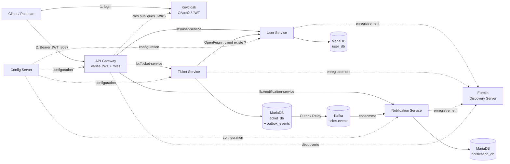
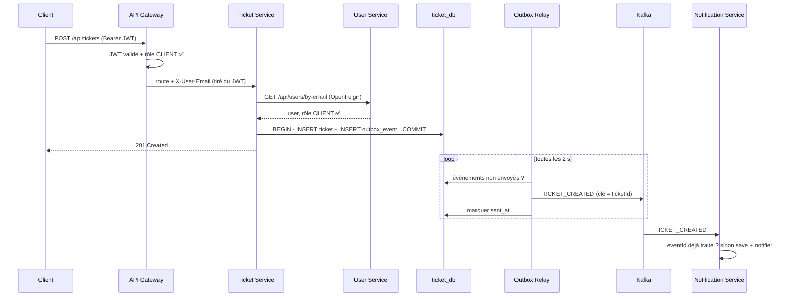

# 🎫 TicketFlow

Plateforme **microservices** de gestion d'incidents et de demandes clients (type opérateur télécom), construite avec **Spring Boot** et **Spring Cloud**.

> Cycle de vie d'un ticket : `OPEN → ASSIGNED → ESCALATED → CLOSED`

## 🚧 Statut

En cours de développement — **Étapes 1 à 5 terminées ✅** (MVP, Config Server + OpenFeign, Kafka + Notifications, Transactional Outbox, Sécurité Keycloak)

## 🏗️ Architecture



| Service | Rôle | Port |
|---|---|---|
| `config-server` | Configuration centralisée (profils `default` / `docker`) | 8888 |
| `discovery-server` | Annuaire des services (Eureka) | 8761 |
| `api-gateway` | Point d'entrée unique : routage, validation JWT, contrôle des rôles | 8087 |
| `keycloak` | Serveur d'identité (OAuth2 / OpenID Connect), realm importé au démarrage | 8180 |
| `user-service` | Gestion des clients et agents | 8081 |
| `ticket-service` | Gestion des tickets, publication d'événements via Outbox | 8082 |
| `notification-service` | Notifications clients (consumer Kafka idempotent) | 8083 |
| `kafka` | Broker de messages (mode KRaft, sans Zookeeper) | 9092 |
| `kafka-ui` | Interface web pour Kafka | 8090 |

**Principes :**
- **Database per Service** : chaque service possède sa propre base MariaDB.
- **Communication synchrone** (OpenFeign) quand une réponse immédiate est nécessaire : ticket-service vérifie que le client existe et a le rôle `CLIENT`.
- **Communication asynchrone** (Kafka) pour découpler les services : la création d'un ticket ne dépend pas de la disponibilité du service de notifications.
- **Transactional Outbox** : le ticket et son événement sont écrits dans la **même transaction** (table `outbox_events`). Un relay planifié publie ensuite vers Kafka : aucun événement perdu, même si Kafka est indisponible.
- **Idempotence** : la livraison est *at-least-once*, donc chaque événement porte un `eventId` unique et notification-service ignore les doublons.

## 🔐 Sécurité

- **Keycloak** émet des JWT signés (RS256). Le realm `ticketflow` (rôles, client, utilisateurs de démo) est **importé automatiquement** au démarrage.
- **La Gateway est un OAuth2 Resource Server** : elle vérifie la signature du JWT avec les clés publiques de Keycloak (JWKS), sans l'appeler à chaque requête, puis applique les règles de rôles.
- **L'identité vient du token, jamais du body** : la Gateway supprime tout header `X-User-*` envoyé par le client, puis injecte `X-User-Email` et `X-User-Roles` extraits du JWT. ticket-service en déduit le `clientId` ; un client ne peut pas créer de ticket au nom d'un autre.
- **401** = pas de token ou token invalide · **403** = authentifié mais rôle insuffisant.

| Requête | Rôle requis |
|---|---|
| `POST /api/tickets` | `CLIENT` |
| `GET /api/tickets/**` | `AGENT` |
| `PATCH /api/tickets/{id}/status` | `AGENT` |
| `/api/users/**` | `AGENT` |
| `GET /api/notifications` | authentifié (un `CLIENT` ne voit que les siennes, un `AGENT` voit tout) |

**Utilisateurs de démo**
| Utilisateur | Mot de passe | Rôle |
|---|---|---|
| `youssef` | `youssef123` | `CLIENT` |
| `anas` | `anas123` | `AGENT` |

**Obtenir un token**
```http
POST http://localhost:8180/realms/ticketflow/protocol/openid-connect/token
Content-Type: application/x-www-form-urlencoded

grant_type=password&client_id=ticketflow-app&username=youssef&password=youssef123
```
Puis appeler l'API avec le header `Authorization: Bearer <access_token>`.

## 🔄 Flux : création d'un ticket



## 🛠️ Stack

Java 21 · Spring Boot 4 · Spring Cloud (Config Server, Eureka, Gateway, OpenFeign) · Spring Security (OAuth2 Resource Server) · Keycloak · Spring Data JPA · Spring for Apache Kafka · Apache Kafka (KRaft) · MariaDB · Lombok · Docker · Docker Compose

## 🚀 Lancer le projet

**Prérequis :** Docker Desktop

```bash
git clone https://github.com/anasxaz/ticketflow.git
cd ticketflow/docker
docker compose up --build -d
```

⏳ Compter 1 à 2 minutes pour que tous les services s'enregistrent.

| Interface | URL |
|---|---|
| API (via la Gateway) | http://localhost:8087 |
| Dashboard Eureka | http://localhost:8761 |
| Kafka UI | http://localhost:8090 |
| Keycloak (admin / admin) | http://localhost:8180 |
| Config Server (ex.) | http://localhost:8888/ticket-service/docker |

## 📡 Endpoints

Toutes les requêtes passent par la Gateway (`localhost:8087`) avec un token JWT (voir 🔐 Sécurité).

**Users**
| Méthode | URL | Description |
|---|---|---|
| GET | `/api/users` | Lister les utilisateurs |
| GET | `/api/users/{id}` | Détail d'un utilisateur (404 si inexistant) |
| POST | `/api/users` | Créer un utilisateur (`CLIENT` ou `AGENT`) |
| DELETE | `/api/users/{id}` | Supprimer un utilisateur |

**Tickets**
| Méthode | URL | Description |
|---|---|---|
| GET | `/api/tickets` | Lister les tickets |
| GET | `/api/tickets/{id}` | Détail d'un ticket (404 si inexistant) |
| POST | `/api/tickets` | Créer un ticket (statut `OPEN` auto, client déduit du token) |
| PATCH | `/api/tickets/{id}/status` | Changer le statut |
| DELETE | `/api/tickets/{id}` | Supprimer un ticket |

**Notifications**
| Méthode | URL | Description |
|---|---|---|
| GET | `/api/notifications` | Notifications (les siennes pour un client, toutes pour un agent) |

**Exemple : créer un ticket** (token de `youssef`)
```json
POST /api/tickets
{
  "title": "Pas de connexion internet",
  "description": "Box éteinte depuis ce matin",
  "priority": "HIGH"
}
```

**Erreurs gérées**
| Cas | Réponse |
|---|---|
| Pas de token / token invalide | `401` |
| Rôle insuffisant | `403` |
| Utilisateur du token sans profil en base | `403` |
| Ressource introuvable | `404` |

## 🗺️ Roadmap

- [x] **1. MVP** : User, Ticket, Gateway, Eureka, Docker Compose
- [x] **2. Config Server + OpenFeign** : configuration centralisée, profil docker, validation du client
- [x] **3. Kafka + Notification Service** : événements `ticket-events`, consumer idempotent
- [x] **4. Transactional Outbox** : plus de *dual write*, événements garantis même si Kafka tombe
- [x] **5. Sécurité Keycloak** : OAuth2 / JWT, rôles `CLIENT` / `AGENT`, identité tirée du token
- [ ] 6. Saga Camunda avec compensation + escalade SLA
- [ ] 7. Resilience4j + Zipkin
- [ ] 8. Observabilité : Prometheus, Grafana, Loki
- [ ] 9. Tests d'intégration avec Testcontainers
- [ ] 10. GitLab CI + Kubernetes
- [ ] 11. Front Angular minimal + ADR

## 👤 Auteur

**Anas Benamara** · [GitHub](https://github.com/anasxaz) · [LinkedIn](https://www.linkedin.com/in/anas-benamara)
