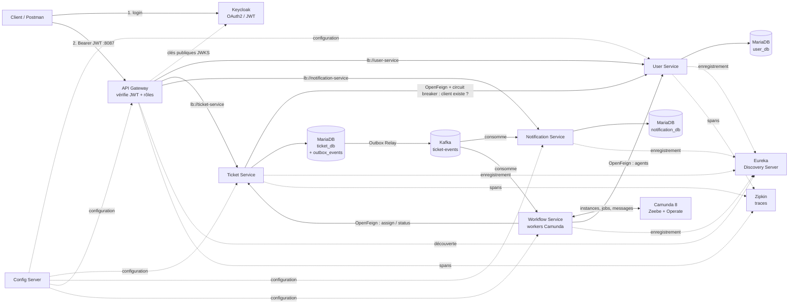
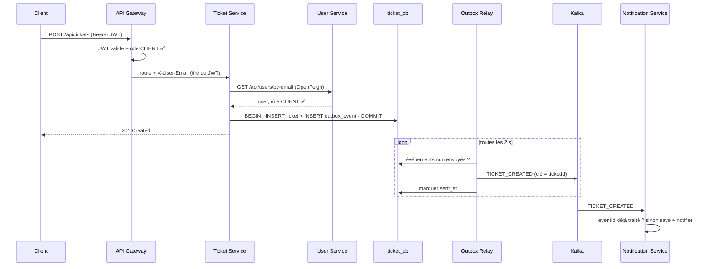
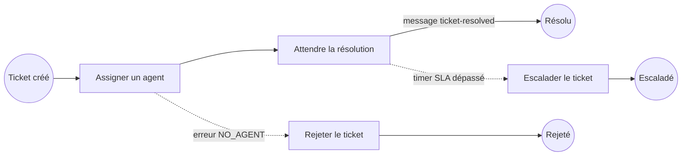
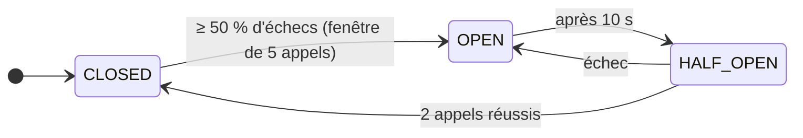
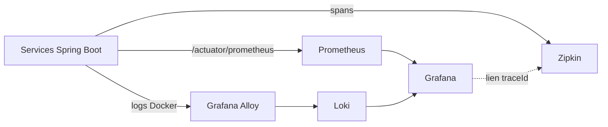

# 🎫 TicketFlow

Plateforme **microservices** de gestion d'incidents et de demandes clients (type opérateur télécom), construite avec **Spring Boot**, **Spring Cloud** et orchestrée par **Camunda 8**.

> Cycle de vie d'un ticket : `OPEN → ASSIGNED → CLOSED` · ou `ESCALATED` si le SLA est dépassé · ou `REJECTED` si aucun agent n'est disponible

## 🚧 Statut

En cours de développement — **Étapes 1 à 9 terminées ✅** (MVP, Config Server + OpenFeign, Kafka + Notifications, Transactional Outbox, Sécurité Keycloak, Workflow Camunda : Saga + escalade SLA, Résilience + Tracing distribué, Observabilité : Prometheus, Grafana, Loki, Tests d'intégration Testcontainers)

## 🏗️ Architecture



| Service | Rôle | Port |
|---|---|---|
| `config-server` | Configuration centralisée (profils `default` / `docker`) | 8888 |
| `discovery-server` | Annuaire des services (Eureka) | 8761 |
| `api-gateway` | Point d'entrée unique : routage, validation JWT, contrôle des rôles | 8087 |
| `keycloak` | Serveur d'identité (OAuth2 / OpenID Connect), realm importé au démarrage | 8180 |
| `user-service` | Gestion des clients et agents | 8081 |
| `ticket-service` | Gestion des tickets, publication d'événements via Outbox | 8082 |
| `notification-service` | Notifications clients (consumer Kafka idempotent) | 8083 |
| `workflow-service` | Orchestration du cycle de vie (Camunda) : assignation, SLA, compensation | 8084 |
| `camunda` | Moteur de workflow Zeebe + Operate (H2 en dev) | 8088 / 26500 |
| `kafka` | Broker de messages (mode KRaft, sans Zookeeper) | 9092 |
| `kafka-ui` | Interface web pour Kafka | 8090 |
| `zipkin` | Collecte et visualisation des traces distribuées | 9411 |
| `prometheus` | Collecte des métriques (scraping de `/actuator/prometheus`) | 9090 |
| `grafana` | Dashboards (métriques Prometheus + logs Loki), provisionnés as code | 3000 |
| `loki` | Stockage et recherche des logs centralisés | 3100 |
| `alloy` | Collecteur des logs Docker → Loki | 12345 |

**Principes :**
- **Database per Service** : chaque service possède sa propre base MariaDB.
- **Communication synchrone** (OpenFeign) quand une réponse immédiate est nécessaire : ticket-service vérifie que le client existe et a le rôle `CLIENT`.
- **Communication asynchrone** (Kafka) pour découpler les services : la création d'un ticket ne dépend pas de la disponibilité du service de notifications.
- **Transactional Outbox** : le ticket et son événement sont écrits dans la **même transaction** (table `outbox_events`). Un relay planifié publie ensuite vers Kafka : aucun événement perdu, même si Kafka est indisponible.
- **Idempotence** : la livraison est *at-least-once*, donc chaque événement porte un `eventId` unique et notification-service ignore les doublons.
- **Orchestration** (Camunda) pour le processus métier long : le cycle de vie d'un ticket est un modèle **BPMN** visible et versionné, pas du code dispersé entre services.

## 🔐 Sécurité

- **Keycloak** émet des JWT signés (RS256). Le realm `ticketflow` (rôles, client, utilisateurs de démo) est **importé automatiquement** au démarrage.
- **La Gateway est un OAuth2 Resource Server** : elle vérifie la signature du JWT avec les clés publiques de Keycloak (JWKS), sans l'appeler à chaque requête, puis applique les règles de rôles.
- **L'identité vient du token, jamais du body** : la Gateway supprime tout header `X-User-*` envoyé par le client, puis injecte `X-User-Email` et `X-User-Roles` extraits du JWT. ticket-service en déduit le `clientId` ; un client ne peut pas créer de ticket au nom d'un autre.
- **401** = pas de token ou token invalide · **403** = authentifié mais rôle insuffisant.

| Requête | Rôle requis |
|---|---|
| `POST /api/tickets` | `CLIENT` |
| `GET /api/tickets/**` | `AGENT` |
| `PATCH /api/tickets/{id}/status` | `AGENT` |
| `/api/users/**` | `AGENT` |
| `GET /api/notifications` | authentifié (un `CLIENT` ne voit que les siennes, un `AGENT` voit tout) |

**Utilisateurs de démo**
| Utilisateur | Mot de passe | Rôle |
|---|---|---|
| `youssef` | `youssef123` | `CLIENT` |
| `anas` | `anas123` | `AGENT` |

**Obtenir un token**
```http
POST http://localhost:8180/realms/ticketflow/protocol/openid-connect/token
Content-Type: application/x-www-form-urlencoded

grant_type=password&client_id=ticketflow-app&username=youssef&password=youssef123
```
Puis appeler l'API avec le header `Authorization: Bearer <access_token>`.

## 🔄 Flux : création d'un ticket



## ⚙️ Workflow Camunda : Saga + escalade SLA

Chaque `TICKET_CREATED` lu sur Kafka démarre une instance du processus BPMN `ticket-lifecycle`. Les étapes sont exécutées par des **job workers** (`@JobWorker`) du workflow-service.



| Scénario | Mécanisme BPMN | Résultat |
|---|---|---|
| Agent ferme le ticket à temps | **Receive task** + message `ticket-resolved` (corrélé par `ticketId`, envoyé quand `STATUS_CHANGED → CLOSED`) | Timer annulé, fin **Résolu** |
| SLA dépassé | **Boundary timer** interrompant (`slaDuration`, `PT2M` en démo, configurable) | Ticket `ESCALATED`, fin **Escaladé** |
| Aucun agent disponible | **Erreur BPMN** `NO_AGENT` levée par le worker + **chemin de compensation** | Ticket `REJECTED`, client notifié, fin **Rejeté** |

**Points clés :**
- **Erreur métier ≠ panne technique** : une erreur BPMN suit la branche prévue ; une exception technique (service indisponible) déclenche des **retries** (3), puis un **incident** visible et relançable dans Operate.
- Chaque changement de statut passe par ticket-service → Outbox → Kafka : le client est notifié quel que soit le chemin.
- Le BPMN est déployé automatiquement au démarrage (`@Deployment`) et **versionné** par Camunda.

## 🛡️ Résilience et observabilité

**Circuit breaker (Resilience4j)** sur l'appel OpenFeign ticket-service → user-service :



- **Timeout de 3 s** : un appel trop lent compte comme un échec.
- **Fallback** (`FallbackFactory`) : si user-service est indisponible, la création de ticket répond **`503` immédiatement** avec un message clair, au lieu de bloquer les threads de ticket-service (pas de panne en cascade).
- Les erreurs **4xx** (ex. utilisateur introuvable) sont des réponses métier : elles **ne comptent pas** comme des pannes et sont renvoyées telles quelles.

**Tracing distribué (Micrometer Tracing + Zipkin)** :
- Chaque requête reçoit un **traceId**, propagé par la Gateway et par Feign (`feign-micrometer`) : le trajet `api-gateway → ticket-service → user-service` s'affiche sur une seule frise dans Zipkin.
- Le traceId apparaît aussi dans les logs (`[traceId-spanId]`), ce qui permet de relier les logs de plusieurs services.
- Échantillonnage à 100 % en dev ; les tâches `@Scheduled` (relay Outbox) sont exclues du tracing pour éviter le bruit.

## 📊 Observabilité : métriques, logs, traces

Les **3 piliers** sont en place et réunis dans **Grafana** :

| Pilier | Question | Outil | Collecte |
|---|---|---|---|
| Métriques | **Quoi ?** (débit, erreurs, mémoire JVM…) | Micrometer → **Prometheus** | *pull* : scraping de `/actuator/prometheus` toutes les 15 s |
| Logs | **Pourquoi ?** (message d'erreur exact) | **Grafana Alloy** → **Loki** | *push* : Alloy lit les logs Docker de tous les containers |
| Traces | **Où ?** (trajet de la requête) | Micrometer Tracing → **Zipkin** | *push* : spans envoyés par chaque service |



- **Grafana as code** : les datasources (Prometheus, Loki) et les dashboards (JVM Micrometer + dashboard `TicketFlow`) sont **provisionnés** depuis `docker/grafana/`, donc disponibles dès le démarrage, sans configuration manuelle.
- **Dashboard `TicketFlow`** (PromQL) : requêtes/seconde et erreurs 5xx/seconde par service, par exemple `sum by (application) (rate(http_server_requests_seconds_count{status=~"5.."}[1m]))`.
- **Logs ↔ traces** : Grafana détecte le `traceId` dans chaque ligne de log Loki et affiche un lien **« Voir dans Zipkin »** qui ouvre la trace correspondante.
- **Scénario de démo** : arrêter `user-service` → pic d'erreurs 5xx sur le dashboard, logs `CallNotPermittedException → fallback` dans Loki, trace de la requête dans Zipkin.

Exemples de requêtes LogQL :
```
{container="ticket-service"} |= "Outbox"
{container=~".*-service"} |= "WARN"
```

## 🧪 Tests d'intégration (Testcontainers)

Les tests démarrent de **vraies dépendances** dans des containers Docker jetables : **MariaDB** et **Kafka** (`apache/kafka-native`). Spring Boot s'y connecte automatiquement grâce à `@ServiceConnection`. Pas de H2 ni de Kafka embarqué : les tests utilisent **les mêmes technologies qu'en production**.

- Les appels vers les autres services (OpenFeign) sont **mockés** (`@MockitoBean`) : chaque service est testé isolément.
- Les containers sont **partagés** entre toutes les classes de test (pattern singleton) pour des tests rapides.
- L'asynchrone (relay Outbox, consumer Kafka) est vérifié avec **Awaitility**, sans `Thread.sleep`.

| Service | Test | Garantie prouvée |
|---|---|---|
| ticket-service | Création d'un ticket | Ticket **et** événement `TICKET_CREATED` écrits dans la même transaction |
| ticket-service | Utilisateur non `CLIENT` | Création refusée, rien n'est écrit en base |
| ticket-service | Échec d'écriture de l'événement (`@MockitoSpyBean`) | **Rollback** du ticket : jamais de ticket sans événement (atomicité de l'Outbox) |
| ticket-service | Relay Outbox | L'événement arrive dans le **vrai Kafka** (clé = `ticketId`) et `sent_at` est renseigné |
| notification-service | Même événement reçu 2 fois | Une seule notification (**consumer idempotent**) |
| notification-service | Doublon envoyé via Kafka | Idempotence vérifiée **de bout en bout**, en s'appuyant sur l'ordre garanti par partition |

```bash
# Prérequis : Docker Desktop lancé
cd ticket-service && ./mvnw test
cd notification-service && ./mvnw test
```

## 🛠️ Stack

Java 21 · Spring Boot 4 · Spring Cloud (Config Server, Eureka, Gateway, OpenFeign) · Spring Security (OAuth2 Resource Server) · Keycloak · **Camunda 8 (Zeebe, BPMN)** · **Resilience4j** · **Micrometer Tracing + Zipkin** · **Prometheus · Grafana · Loki · Grafana Alloy** · Spring Data JPA · Spring for Apache Kafka · Apache Kafka (KRaft) · MariaDB · Lombok · Docker · Docker Compose · **JUnit 5 · Testcontainers · Mockito · Awaitility**

## 🚀 Lancer le projet

**Prérequis :** Docker Desktop

```bash
git clone https://github.com/anasxaz/ticketflow.git
cd ticketflow/docker
docker compose up --build -d
```

⏳ Compter 1 à 2 minutes pour que tous les services s'enregistrent.

| Interface | URL |
|---|---|
| API (via la Gateway) | http://localhost:8087 |
| Dashboard Eureka | http://localhost:8761 |
| Kafka UI | http://localhost:8090 |
| Keycloak (admin / admin) | http://localhost:8180 |
| Camunda Operate (demo / demo) | http://localhost:8088/operate |
| Zipkin (traces) | http://localhost:9411 |
| Grafana (admin / admin) | http://localhost:3000 |
| Prometheus (cibles) | http://localhost:9090/targets |
| Alloy (pipeline de logs) | http://localhost:12345 |
| État du circuit breaker (health) | http://localhost:8082/actuator/health |
| Config Server (ex.) | http://localhost:8888/ticket-service/docker |

## 📡 Endpoints

Toutes les requêtes passent par la Gateway (`localhost:8087`) avec un token JWT (voir 🔐 Sécurité).

**Users**
| Méthode | URL | Description |
|---|---|---|
| GET | `/api/users` | Lister les utilisateurs |
| GET | `/api/users/{id}` | Détail d'un utilisateur (404 si inexistant) |
| POST | `/api/users` | Créer un utilisateur (`CLIENT` ou `AGENT`) |
| DELETE | `/api/users/{id}` | Supprimer un utilisateur |

**Tickets**
| Méthode | URL | Description |
|---|---|---|
| GET | `/api/tickets` | Lister les tickets |
| GET | `/api/tickets/{id}` | Détail d'un ticket (404 si inexistant) |
| POST | `/api/tickets` | Créer un ticket (statut `OPEN` auto, client déduit du token) |
| PATCH | `/api/tickets/{id}/status` | Changer le statut (`CLOSED` termine le workflow sur **Résolu**) |
| PATCH | `/api/tickets/{id}/assign` | Assigner un agent (appelé par le workflow-service) |
| DELETE | `/api/tickets/{id}` | Supprimer un ticket |

**Notifications**
| Méthode | URL | Description |
|---|---|---|
| GET | `/api/notifications` | Notifications (les siennes pour un client, toutes pour un agent) |

**Exemple : créer un ticket** (token de `youssef`)
```json
POST /api/tickets
{
  "title": "Pas de connexion internet",
  "description": "Box éteinte depuis ce matin",
  "priority": "HIGH"
}
```

**Erreurs gérées**
| Cas | Réponse |
|---|---|
| Pas de token / token invalide | `401` |
| Rôle insuffisant | `403` |
| Utilisateur du token sans profil en base | `403` |
| Ressource introuvable | `404` |
| user-service indisponible (circuit breaker / fallback) | `503` |

## 🗺️ Roadmap

- [x] **1. MVP** : User, Ticket, Gateway, Eureka, Docker Compose
- [x] **2. Config Server + OpenFeign** : configuration centralisée, profil docker, validation du client
- [x] **3. Kafka + Notification Service** : événements `ticket-events`, consumer idempotent
- [x] **4. Transactional Outbox** : plus de *dual write*, événements garantis même si Kafka tombe
- [x] **5. Sécurité Keycloak** : OAuth2 / JWT, rôles `CLIENT` / `AGENT`, identité tirée du token
- [x] **6. Workflow Camunda 8** : BPMN, assignation automatique, escalade SLA (timer), résolution (message), Saga avec compensation
- [x] **7. Résilience + Tracing** : circuit breaker Resilience4j avec fallback `503`, tracing distribué Micrometer + Zipkin
- [x] **8. Observabilité** : métriques Prometheus, logs centralisés Loki + Alloy, dashboards Grafana provisionnés, lien logs → traces Zipkin
- [x] **9. Tests d'intégration** : Testcontainers (MariaDB, Kafka), atomicité de l'Outbox, relay Kafka, idempotence du consumer
- [ ] 10. GitLab CI + Kubernetes
- [ ] 11. Front Angular minimal + ADR

## 👤 Auteur

**Anas Benamara** · [GitHub](https://github.com/anasxaz) · [LinkedIn](https://www.linkedin.com/in/anas-benamara)
