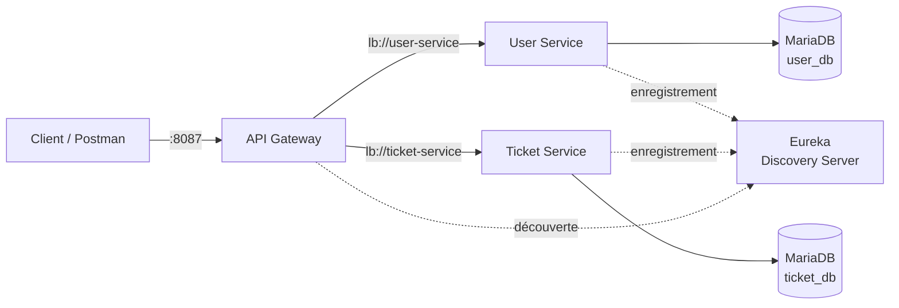

# 🎫 TicketFlow

Plateforme **microservices** de gestion d'incidents et de demandes clients (type opérateur télécom), construite avec **Spring Boot** et **Spring Cloud**.

> Cycle de vie d'un ticket : `OPEN → ASSIGNED → ESCALATED → CLOSED`

## 🚧 Statut

En cours de développement — **Étape 1 (MVP) terminée ✅**

## 🏗️ Architecture



| Service | Rôle | Port |
|---|---|---|
| `discovery-server` | Annuaire des services (Eureka) | 8761 |
| `api-gateway` | Point d'entrée unique, routage | 8087 |
| `user-service` | Gestion des clients et agents | 8081 |
| `ticket-service` | Gestion des tickets et de leur statut | 8082 |

**Principe :** une base de données par service (*Database per Service*).

## 🛠️ Stack

Java 21 · Spring Boot 4 · Spring Cloud (Eureka, Gateway) · Spring Data JPA · MariaDB · Lombok · Docker · Docker Compose

## 🚀 Lancer le projet

**Prérequis :** Docker Desktop

```bash
git clone https://github.com/anasxaz/ticketflow.git
cd ticketflow/docker
docker compose up --build
```

- Dashboard Eureka : http://localhost:8761
- API (via la Gateway) : http://localhost:8087

## 📡 Endpoints

**Users**
| Méthode | URL | Description |
|---|---|---|
| GET | `/api/users` | Lister les utilisateurs |
| GET | `/api/users/{id}` | Détail d'un utilisateur |
| POST | `/api/users` | Créer un utilisateur |
| DELETE | `/api/users/{id}` | Supprimer un utilisateur |

**Tickets**
| Méthode | URL | Description |
|---|---|---|
| GET | `/api/tickets` | Lister les tickets |
| GET | `/api/tickets/{id}` | Détail d'un ticket |
| POST | `/api/tickets` | Créer un ticket (statut `OPEN` auto) |
| PATCH | `/api/tickets/{id}/status` | Changer le statut |
| DELETE | `/api/tickets/{id}` | Supprimer un ticket |

**Exemple : créer un ticket**
```json
POST /api/tickets
{
  "title": "Pas de connexion internet",
  "description": "Box éteinte depuis ce matin",
  "priority": "HIGH",
  "clientId": 4
}
```

## 🗺️ Roadmap

- [x] **1. MVP** : User, Ticket, Gateway, Eureka, Docker Compose
- [ ] 2. Config Server + OpenFeign
- [ ] 3. Kafka + Notification Service (consumer idempotent)
- [ ] 4. Outbox pattern
- [ ] 5. Sécurité avec Keycloak (OAuth2 / JWT)
- [ ] 6. Saga Camunda avec compensation + escalade SLA
- [ ] 7. Resilience4j + Zipkin
- [ ] 8. Observabilité : Prometheus, Grafana, Loki
- [ ] 9. Tests d'intégration avec Testcontainers
- [ ] 10. GitLab CI + Kubernetes
- [ ] 11. Front Angular minimal + ADR

## 👤 Auteur

**Anas Benamara** · [GitHub](https://github.com/anasxaz) · [LinkedIn](https://www.linkedin.com/in/anas-benamara)
