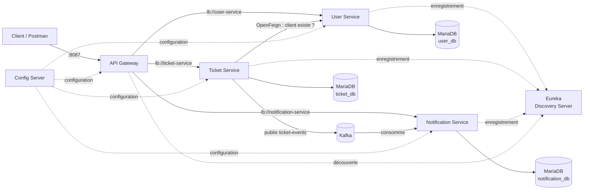
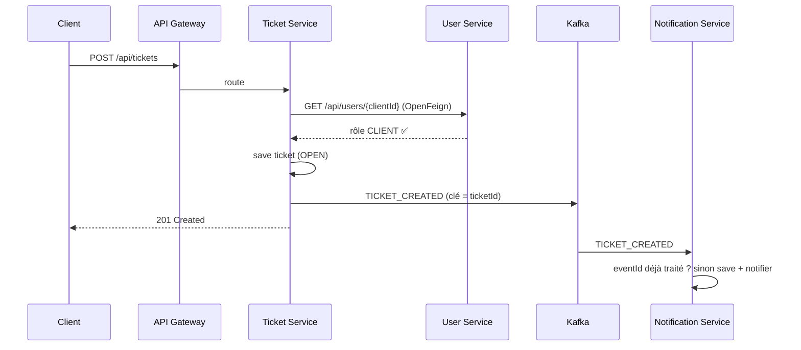

# 🎫 TicketFlow

Plateforme **microservices** de gestion d'incidents et de demandes clients (type opérateur télécom), construite avec **Spring Boot** et **Spring Cloud**.

> Cycle de vie d'un ticket : `OPEN → ASSIGNED → ESCALATED → CLOSED`

## 🚧 Statut

En cours de développement — **Étapes 1 à 3 terminées ✅** (MVP, Config Server + OpenFeign, Kafka + Notifications)

## 🏗️ Architecture



| Service | Rôle | Port |
|---|---|---|
| `config-server` | Configuration centralisée (profils `default` / `docker`) | 8888 |
| `discovery-server` | Annuaire des services (Eureka) | 8761 |
| `api-gateway` | Point d'entrée unique, routage | 8087 |
| `user-service` | Gestion des clients et agents | 8081 |
| `ticket-service` | Gestion des tickets, publication d'événements Kafka | 8082 |
| `notification-service` | Notifications clients (consumer Kafka idempotent) | 8083 |
| `kafka` | Broker de messages (mode KRaft, sans Zookeeper) | 9092 |
| `kafka-ui` | Interface web pour Kafka | 8090 |

**Principes :**
- **Database per Service** : chaque service possède sa propre base MariaDB.
- **Communication synchrone** (OpenFeign) quand une réponse immédiate est nécessaire : ticket-service vérifie que le client existe et a le rôle `CLIENT`.
- **Communication asynchrone** (Kafka) pour découpler les services : la création d'un ticket ne dépend pas de la disponibilité du service de notifications.
- **Idempotence** : chaque événement porte un `eventId` unique, notification-service ignore les doublons.

## 🔄 Flux : création d'un ticket



## 🛠️ Stack

Java 21 · Spring Boot 4 · Spring Cloud (Config Server, Eureka, Gateway, OpenFeign) · Spring Data JPA · Spring for Apache Kafka · Apache Kafka (KRaft) · MariaDB · Lombok · Docker · Docker Compose

## 🚀 Lancer le projet

**Prérequis :** Docker Desktop

```bash
git clone https://github.com/anasxaz/ticketflow.git
cd ticketflow/docker
docker compose up --build -d
```

⏳ Compter 1 à 2 minutes pour que tous les services s'enregistrent.

| Interface | URL |
|---|---|
| API (via la Gateway) | http://localhost:8087 |
| Dashboard Eureka | http://localhost:8761 |
| Kafka UI | http://localhost:8090 |
| Config Server (ex.) | http://localhost:8888/ticket-service/docker |

## 📡 Endpoints

Toutes les requêtes passent par la Gateway (`localhost:8087`).

**Users**
| Méthode | URL | Description |
|---|---|---|
| GET | `/api/users` | Lister les utilisateurs |
| GET | `/api/users/{id}` | Détail d'un utilisateur (404 si inexistant) |
| POST | `/api/users` | Créer un utilisateur (`CLIENT` ou `AGENT`) |
| DELETE | `/api/users/{id}` | Supprimer un utilisateur |

**Tickets**
| Méthode | URL | Description |
|---|---|---|
| GET | `/api/tickets` | Lister les tickets |
| GET | `/api/tickets/{id}` | Détail d'un ticket (404 si inexistant) |
| POST | `/api/tickets` | Créer un ticket (statut `OPEN` auto, client vérifié) |
| PATCH | `/api/tickets/{id}/status` | Changer le statut |
| DELETE | `/api/tickets/{id}` | Supprimer un ticket |

**Notifications**
| Méthode | URL | Description |
|---|---|---|
| GET | `/api/notifications` | Lister les notifications envoyées |

**Exemple : créer un ticket**
```json
POST /api/tickets
{
  "title": "Pas de connexion internet",
  "description": "Box éteinte depuis ce matin",
  "priority": "HIGH",
  "clientId": 2
}
```

**Erreurs gérées**
| Cas | Réponse |
|---|---|
| `clientId` inexistant | `400` — `Client not found: 999` |
| `clientId` d'un agent | `400` — `User 1 is not a CLIENT` |
| Ressource introuvable | `404` |

## 🗺️ Roadmap

- [x] **1. MVP** : User, Ticket, Gateway, Eureka, Docker Compose
- [x] **2. Config Server + OpenFeign** : configuration centralisée, profil docker, validation du client
- [x] **3. Kafka + Notification Service** : événements `ticket-events`, consumer idempotent
- [ ] 4. Outbox pattern
- [ ] 5. Sécurité avec Keycloak (OAuth2 / JWT)
- [ ] 6. Saga Camunda avec compensation + escalade SLA
- [ ] 7. Resilience4j + Zipkin
- [ ] 8. Observabilité : Prometheus, Grafana, Loki
- [ ] 9. Tests d'intégration avec Testcontainers
- [ ] 10. GitLab CI + Kubernetes
- [ ] 11. Front Angular minimal + ADR

## 👤 Auteur

**Anas Benamara** · [GitHub](https://github.com/anasxaz) · [LinkedIn](https://www.linkedin.com/in/anas-benamara)
